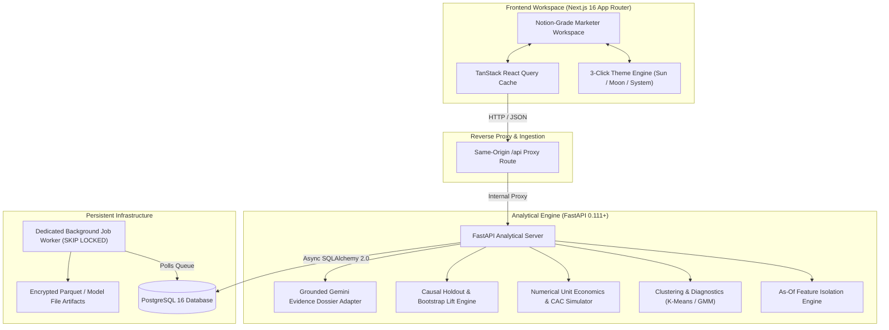

<div align="center">

# ✦ Persona Studio (`persona.studio`) ✦
### *Where Customer Personas and Campaigns Create Together.*

An enterprise-grade, evidence-backed marketing analytics and economics platform. Built with **FastAPI**, **Next.js 16**, **PostgreSQL 16**, and an authentic **Notion Design System** featuring 3-mode theme switching (☀️/🌙/💻) and hand-drawn ink vector art.

[](https://opensource.org/licenses/MIT)
[](https://python.org)
[](https://fastapi.tiangolo.com)
[](https://nextjs.org)
[](https://typescriptlang.org)
[](https://postgresql.org)
[](https://docker.com)
[](https://notion.com)

[Explore Documentation](docs/) • [Architecture](docs/ARCHITECTURE.md) • [Metric Dictionary](docs/METRIC_DICTIONARY.md) • [Report](UNIVERSITY_PROJECT_REPORT.md)

---

</div>

## 📌 Executive Summary

Modern growth teams frequently struggle with fragmented data: machine learning engineers generate clusters in isolated notebooks, marketers draft briefs without financial constraints, and performance teams deploy ad spend without measuring true incremental causal lift.

**Persona Studio** solves this by unifying:
1. **Temporal As-Of Feature Engineering**: Prevents temporal leakage using strict 180-day lookback windows and separates **Verified Prospects** from **Existing Repeat Buyers**.
2. **Behavioral Clustering Diagnostics**: Unsupervised K-Means and Gaussian Mixture Models benchmarked against Silhouette Scores ($\ge 0.15$), Davies–Bouldin, Calinski–Harabasz, and 5-fold Adjusted Rand Index (ARI) subsample stability ($\ge 0.60$).
3. **Numerical Unit Economics & CAC Simulator**: Closed-form analytical profit waterfalls, 12-month finite-horizon subscription churn modeling, and 1,000-draw Monte Carlo binomial risk simulations.
4. **Pre-Registered Randomized Holdout Experiments**: Intention-to-Treat (ITT) evaluation powered by 2,000 stratified customer-level bootstrap confidence intervals.
5. **Authentic Notion UI/UX**: Distinctive editorial aesthetics, 3-mode theme switcher (☀️ Light, 🌙 Dark, 💻 System), 10 iconic Notion tag pill badges, and vector ink illustrations.

---

## 🏛️ System Architecture



---

## 🎨 Notion-Grade Design System

Persona Studio implements Notion’s design language:
- **3-Click Adaptive Theme Engine**:
  - ☀️ **Light Mode**: Crisp warm paper white (`#FFFFFF` / `#F7F7F5`), dark graphite ink typography (`#37352F`), and soft neutral borders (`#E9E9E7`).
  - 🌙 **Dark Mode**: Deep obsidian charcoal (`#191919` / `#202020`), soft gray typography (`#FFFFFF` / `#9B9B9B`), and dark borders (`#2F2F2F`).
  - 💻 **System Mode**: Automatically listens to OS `window.matchMedia("(prefers-color-scheme: dark)")` and adjusts dynamically.
- **Hand-Drawn Vector Art**: Bespoke SVG artwork with stippling dot patterns and accents (girls and boys, typewriter on stacked books, paper planes, idea boards, and desk analysts).
- **Notion 3D Isometric Logo**: Bespoke isometric book/cube emblem with a hand-drawn spine and a warm yellow sticky note accent, accompanied by the bold **Persona** wordmark.
- **10 Canonical Notion Tag Pills**: Gray, Brown, Orange, Yellow, Green, Blue, Purple, Pink, Red, and Default with light and dark mode styles.
- **Block-Based Hierarchy**: Notion cards, toggle callout blocks, and database views.

---

## 💎 Core Modules & Capabilities

### 1. 🗄️ Data Hub & As-Of Temporal Feature Store
- **Ingestion Support**: Ingests customers, order lines, offerings, engagement events, and experiment outcomes.
- **Zero-State Integrity**: When initialized, all views default cleanly to 0 until a dataset is loaded or uploaded.
- **1-Click Retail Ingestion**: Pre-bundled with 2,000 real retail shoppers and 18,301 transaction lines.
- **Public Kaggle Benchmarks**: Guides for UCI Online Retail II (541k rows), Brazilian Olist (100k orders), and Instacart Market Basket (3M orders).
- **Leakage Prevention**: Enforces a strict 180-day lookback window cutoff to eliminate temporal lookahead bias.

### 2. 👥 Behavioral Persona Studio & Diagnostics
- **Unsupervised Clustering**: Preprocesses skewed metrics via $\log(1 + x)$, 1st/99th percentile outlier capping, and robust scaling.
- **Mathematical Diagnostics**:
  - **Silhouette Coefficient**: Enforces cluster cohesion $\ge 0.15$.
  - **Davies–Bouldin & Calinski–Harabasz**: Evaluates separation distance.
  - **5-Fold Subsample ARI Stability**: Tests cluster reproducibility ($\ge 0.60$).
- **Evidence Dossier (480px Drawer)**: Every persona claim is backed by an immutable `EvidenceMetric` record with sample size, aggregation formula, and population baseline.
- **Privacy First**: Customer tables mask PII (`jo***@domain.com`).

### 3. 🎯 Customer Acquisition Cost (CAC) Simulator
- **Analytical Profit Waterfall**:
  $$\text{Net Revenue} = \text{Gross Revenue} - \text{Discounts} - \text{Refunds}$$
  $$\text{Contribution Profit} = \text{Net Revenue} - \text{COGS} - \text{Payment Fees} - \text{Media Spend} - \text{Fixed Launch Cost}$$
- **Break-Even Mechanics**:
  - Allowable CAC target based on gross margin and customer payback period.
  - Break-even CPC threshold based on target audience conversion probability.
- **Monte Carlo Risk Engine**: 1,000 seeded binomial purchaser draws simulating outcome distributions (Median, 10th percentile worst-case, 90th percentile upside, and Probability of Profit).
- **Concave Budget Allocation**: Diminishing marginal returns optimizer across multi-channel campaigns.

### 4. 🧪 Pre-Registered Randomized Holdout Experiments
- **Power Sizing Planner**: Built on `statsmodels.stats.power.NormalIndPower` with 95% statistical confidence and 80% power.
- **50/50 Split Stratification**: Balances treatment and holdout groups evenly across behavioral persona strata.
- **Intention-to-Treat (ITT) Estimation**: Measures true incremental uplift above organic baseline purchases.
- **Bootstrap Confidence Intervals**: 2,000 stratified customer-level resamples; automatically marks inconclusive results when confidence intervals cross zero.

---

## 🚀 Quickstart Guide

### Prerequisites
- [Docker](https://www.docker.com/) & Docker Compose **OR**
- Node.js 20+ & Python 3.11+ with PostgreSQL 16

### Option A: 1-Click Docker Compose (Recommended)

```bash
# 1. Clone repository
git clone https://github.com/shivam-core/persona.studio.git
cd persona.studio

# 2. Configure environment
cp .env.example .env

# 3. Start PostgreSQL, Analytical API, Worker, and Web App
docker compose up --build
```

Access the applications:
- **Web App**: [http://localhost:3000](http://localhost:3000)
- **FastAPI Swagger Docs**: [http://localhost:8000/docs](http://localhost:8000/docs)
- **Health Check**: [http://localhost:8000/health](http://localhost:8000/health)

---

### Option B: Local Host Development

#### 1. Start PostgreSQL Database
```bash
docker run -d --name persona-db \
  -e POSTGRES_USER=persona \
  -e POSTGRES_PASSWORD=persona \
  -e POSTGRES_DB=persona \
  -p 5432:5432 \
  postgres:16-alpine
```

#### 2. Backend Setup (FastAPI & Domain Engine)
```bash
cd services/api

# Create & activate virtual environment
python3 -m venv .venv
source .venv/bin/activate

# Install dependencies
pip install -r requirements.txt

# Run migrations & seed baseline workspace
python -m app.db.init_db

# Start the development server
uvicorn app.main:app --host 0.0.0.0 --port 8000 --reload
```

#### 3. Frontend Setup (Next.js 16 Workspace)
```bash
cd apps/web

# Install dependencies
npm install

# Run TypeScript check
npx tsc --noEmit

# Start Next.js dev server
npm run dev
```
Open [http://localhost:3000](http://localhost:3000) to view Persona Studio.

---

## 🧪 Testing & Verification Suite

Persona Studio includes end-to-end integration tests, numerical verifications, and frontend type-safety checks:

```bash
# 1. Backend Numerical & Domain Tests
cd services/api
pytest tests/ -v

# 2. Comprehensive API End-to-End Audit (33 Endpoints)
python ../../scripts/comprehensive_api_audit.py

# 3. Full System Integration Verification
python ../../scratch/elite_full_application_test.py

# 4. Frontend Type Checking
cd apps/web
npx tsc --noEmit
```

---

## 📁 Repository Directory Structure

```text
persona_studio/
├── apps/
│   └── web/                                # Next.js 16 Web Application
│       ├── src/
│       │   ├── app/
│       │   │   ├── cac-simulator/          # CAC Simulator & LTV Waterfall
│       │   │   ├── campaigns/              # Campaign Planner & Allocation
│       │   │   ├── data/                   # Data Hub & CSV Ingestion
│       │   │   ├── experiments/            # A/B Lift Tests & Holdouts
│       │   │   ├── offerings/              # Product Catalog & Fit Score
│       │   │   ├── personas/               # Persona Studio Gallery
│       │   │   ├── segments/               # Clustering & Diagnostic Charts
│       │   │   ├── settings/               # Workspace & Theme Settings
│       │   │   ├── simulator/              # Revenue Forecast Engine
│       │   │   ├── globals.css             # Notion Tokens & Tag Pill Styles
│       │   │   └── page.tsx                # Overview & Hero Dashboard
│       │   ├── components/
│       │   │   ├── brand/PersonaLogo.tsx   # 3D Isometric Notion Logo
│       │   │   ├── illustrations/          # Hand-drawn Vector Illustration Library
│       │   │   ├── layout/                 # Sidebar, TopBar, ThemeToggle
│       │   │   └── providers/ThemeProvider # 3-Click Light/Dark/System Provider
│       │   └── lib/api.ts                  # Typed Analytical API Client
│       └── package.json
├── services/
│   └── api/                                # FastAPI Analytical Microservice
│       ├── app/
│       │   ├── api/routes/                 # REST Route Handlers (Audiences, Personas, CAC)
│       │   ├── domain/                     # Mathematical & Domain Algorithms
│       │   │   ├── segmentation/           # K-Means, GMM, PCA, ARI Diagnostics
│       │   │   ├── simulation/             # CAC Waterfall, Monte Carlo Engine
│       │   │   ├── experiments/            # Randomized Holdout & Bootstrap ITT
│       │   │   ├── optimization/           # Budget Marginal Allocator
│       │   │   └── evidence/               # Evidence Dossier Records
│       │   ├── db/                         # PostgreSQL Models & Engine
│       │   └── main.py                     # App Entrypoint & CORS Config
│       └── requirements.txt
├── scripts/                                # Maintenance & Benchmark Tools
│   ├── comprehensive_api_audit.py          # Complete 33-route test script
│   ├── prepare_real_dataset.py             # 2k retail bundle synthesizer
│   └── convert_kaggle_dataset.py           # Olist / UCI / Instacart converter
├── docker-compose.yml                      # Full-stack Container Definition
├── UNIVERSITY_PROJECT_REPORT.md            # Comprehensive Academic Project Report
└── README.md
```

---

## 📜 Academic Research & Methodological Reference

For academic evaluation, peer review, and statistical proofs, refer to:
- [`UNIVERSITY_PROJECT_REPORT.md`](UNIVERSITY_PROJECT_REPORT.md) — Comprehensive technical report covering introduction, microeconomics literature, algorithmic methodology, empirical results, and future research scope.
- [`docs/METRIC_DICTIONARY.md`](docs/METRIC_DICTIONARY.md) — Lineage definitions for CAC, ROAS, Contribution Margin, and Holdout Lift.
- [`docs/MODEL_CARD.md`](docs/MODEL_CARD.md) — Machine learning model card detailing feature transformations, cluster stability diagnostics, and ethical guardrails.

---

## 👨‍💻 Author & Engineering Credits

Developed with mathematical rigor and UX care by **Shivam Kore** ([@shivam-core](https://github.com/shivam-core)).

Distributed under the **MIT License**. See `LICENSE` for details.
