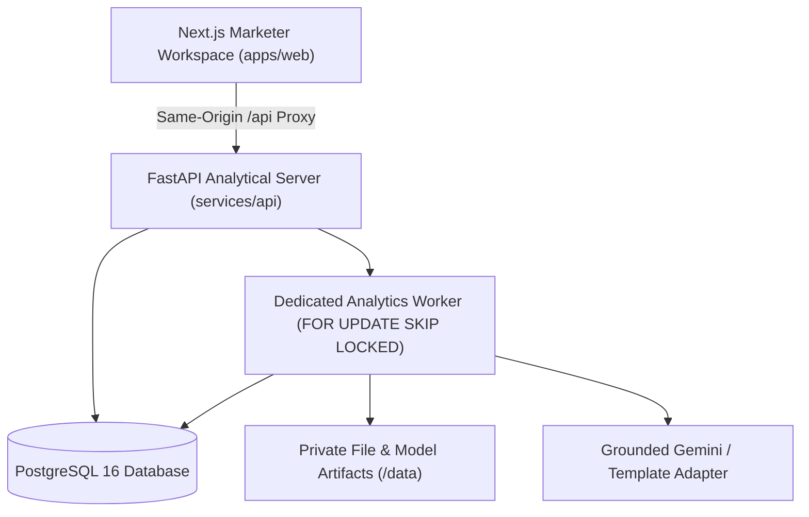

# Persona Studio — Customer Segments & Campaign Planner for Marketers

[]()
[]()
[]()
[]()
[]()

**Persona Studio** is a comprehensive full-stack marketing analytics platform that turns transactional, customer, and engagement data into actionable **evidence-backed behavioral persona cards**, matches those cards to catalog offerings, prepares campaign briefs, simulates unit economics (CAC, ROAS, profit waterfall, Monte Carlo risk), and evaluates incremental causal impact using pre-registered randomized holdout experiments.

Built by **Shivam Kore** as an academic and engineering project combining machine learning, microeconomics, and grounded LLM assistance.

---

## Key Features

1. **Data Hub & As-Of Feature Engineering:**
   - Ingests canonical CSVs (`customers`, `order_lines`, `offerings`, `engagement_events`, `experiment_outcomes`).
   - Line-level schema, referential integrity, and price/discount/refund constraint validation with quarantine tracking.
   - Enforces strict as-of temporal isolation (180-day lookback) to eliminate lookahead bias and temporal leakage.
   - Distinguishes **Existing Buyers** (prior orders before cutoff) from **Verified Prospects** (0 orders with completeness flag) and **Unknown History**.

2. **Unsupervised Behavioral Segmentation & Diagnostics:**
   - Preprocessing with `log1p` on skewed values, 1st/99th percentile capping, robust scaling, and 4-way group weighting.
   - Fits **K-Means** ($K=2..8$, `k-means++`, $n_{\text{init}}=20$) and **Gaussian Mixture Models** (diagonal covariance).
   - Unsupervised diagnostic suite: **Silhouette Score** ($\ge 0.15$), **Davies–Bouldin Index**, **Calinski–Harabasz Index**, and **5-Fold Subsample ARI Stability** ($\ge 0.60$).
   - Interactive 2D PCA projection reporting PC1 and PC2 explained variance.

3. **Persona Studio (Versioned Decision Objects):**
   - Published persona cards with behavioral names, audience counts, and population shares.
   - **Behavioral Fingerprints**: Percentile bars benchmarked against the population with adjacent raw values.
   - **Evidence Dossier (480px Slide-out Drawer)**: Links every claim to immutable `EvidenceMetric` records with sample sizes, aggregation definitions, and baselines.
   - Side-by-side 3-card comparison modal and masked customer profile views (PII protected).
   - Deterministic template wording with optional Gemini API assistance.

4. **Offering Fit Matching Heuristic:**
   - Explainable fit score combining Category Affinity (45%), Spend Compatibility (25%), Recency Engagement (20%), and Category Activity (10%).

5. **CAC & Campaign Economics Simulator:**
   - Pure Python numerical authority for **Paid CPC** ($q = \min(N, B / (CPC \cdot a))$) and **Direct Outreach** models.
   - Exact analytical profit waterfall: Net Revenue $\rightarrow$ COGS/Fees/Refunds $\rightarrow$ Media Spend $\rightarrow$ Fixed Cost $F$ $\rightarrow$ Contribution Profit.
   - Decoupled **Campaign CAC** (for acquisition of verified prospects) vs. **Cost per Repeat Purchaser** (for retention).
   - Break-even conversion probability, break-even CPC, and allowable CAC targets.
   - 12-month finite-horizon subscription modeling with monthly churn and survival discounting.
   - **Monte Carlo 1,000 Draws**: Seeded binomial purchaser realization histograms with median, p10, p90, and probability of positive profit.
   - **Constrained Budget Allocator**: Discretized marginal contribution optimizer under concave saturation curves with a *Do Not Launch* baseline recommendation.

6. **Pre-Registered Randomized Holdout Experiments:**
   - Power & sample size planner using `statsmodels.stats.power.NormalIndPower`.
   - 50/50 randomized holdout assignment stratified by persona card.
   - Intention-to-Treat (ITT) impact analysis with **95% Bootstrap Confidence Intervals** (2,000 stratified customer-level resamples).
   - Inconclusive evidence reporting when CIs span zero. Exploratory persona strata breakdown.

---

## Architecture Overview



---

## Quickstart

### Prerequisites
- Docker & Docker Compose **or** Node.js 20+ and Python 3.11+
- Git

### Option 1: Docker Compose (All-in-One)

```bash
# 1. Clone repository
git clone https://github.com/shivamkore/persona-studio.git
cd persona-studio

# 2. Copy environment file
cp .env.example .env

# 3. Start PostgreSQL, API, Worker, and Frontend
docker compose up --build
```

- Frontend: `http://localhost:3000`
- API Documentation: `http://localhost:8000/docs`
- Health Check: `http://localhost:8000/health`

---

### Option 2: Local Host Development

#### 1. Start PostgreSQL Container
```bash
docker run -d --name persona-db -e POSTGRES_USER=persona -e POSTGRES_PASSWORD=persona -e POSTGRES_DB=persona -p 5432:5432 postgres:16-alpine
```

#### 2. Start FastAPI Backend & Run Migrations
```bash
cd services/api
python3.11 -m venv .venv
source .venv/bin/activate
pip install -e .
alembic upgrade head
uvicorn app.main:app --host 127.0.0.1 --port 8000 --reload
```

#### 3. Start Next.js Frontend
```bash
cd apps/web
npm install
npm run dev -- -p 3000
```

Open `http://localhost:3000` in your browser.

---

## Verification & Testing Suite

### Run Backend Numerical & Analytical Tests
```bash
source services/api/.venv/bin/activate
pytest services/api/tests/ -v
```
All 14 comprehensive test suites exercise:
- Foundation health, readiness, and worker lease lifecycles.
- As-of feature engineering and lookahead leakage prevention.
- K-Means and GMM fitting, Silhouette, and ARI stability diagnostics.
- Golden product economics (exact ₹35,000 profit and ₹250 CAC match).
- Direct retention, subscription survival limits, and modeled cannibalization.
- Constrained budget allocator and 1,000-draw Monte Carlo repeatability.
- Holdout experiment stratification, outcome validation, and ITT bootstrap CIs.

### Run Frontend Lint & Production Build
```bash
cd apps/web
npm run lint    # 0 errors
npm run build   # Static generation of all 9 routes
```

---

## Complete Route Map

| Page Route | Purpose | Key Components |
|---|---|---|
| `/` | Marketing Overview | 4 Scope-explicit KPIs, Observed sales trend, Persona distribution, 6-step checklist |
| `/data` | Data Hub | Dataset snapshot, CSV mapping wizard, Validation & Quarantine table, As-of feature builder |
| `/segments` | Segments & Diagnostics | K-Means vs GMM candidate comparison table, Silhouette & ARI metrics, 2D PCA scatter |
| `/personas` | Persona Studio | Persona card grid, Behavioral fingerprints, 480px Slide-out evidence drawer, 3-Card comparison |
| `/offerings` | Offerings Catalog | Products, services, subscriptions, List price vs COGS, Explainable persona fit breakdown |
| `/campaigns` | Campaign Planner | Campaign brief builder, Frozen audience snapshot, Opt-in consent policy, Creative copy variants |
| `/simulator` | CAC & Profit Simulator | 3-panel workspace: Inputs left, Waterfall & 1k Monte Carlo center, Budget allocator right |
| `/experiments` | Holdout Experiments | NormalIndPower calculator, 50/50 Stratified assignment, ITT uplift card, 95% Bootstrap CI |
| `/settings` | Workspace Settings | Currency, Timezone, Metric dictionary download, Demo reset action |

---

## Documentation

- **[`docs/METRIC_DICTIONARY.md`](docs/METRIC_DICTIONARY.md):** Mathematical definitions for every money, rate, count, refund, CAC, ROAS, and experiment metric.
- **[`docs/MODEL_CARD.md`](docs/MODEL_CARD.md):** ML model card detailing populations, preprocessing, K-Means/GMM, ARI refit stability, and ethics.
- **[`docs/ARCHITECTURE.md`](docs/ARCHITECTURE.md):** System architecture diagrams, database schema, worker execution contracts, and security boundaries.
- **[`docs/DEMO_SCRIPT.md`](docs/DEMO_SCRIPT.md):** 5–7 minute university demonstration script with simple and technical explanations.
- **[`BUILD_STATUS.md`](BUILD_STATUS.md):** Phase-by-phase implementation log and verified checks.
- **[`DECISIONS.md`](DECISIONS.md):** Record of engineering design decisions and trade-offs.

---

## License

Created for academic and university presentation purposes.
