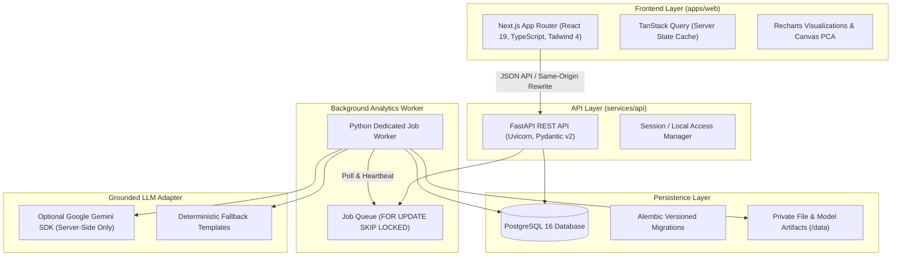
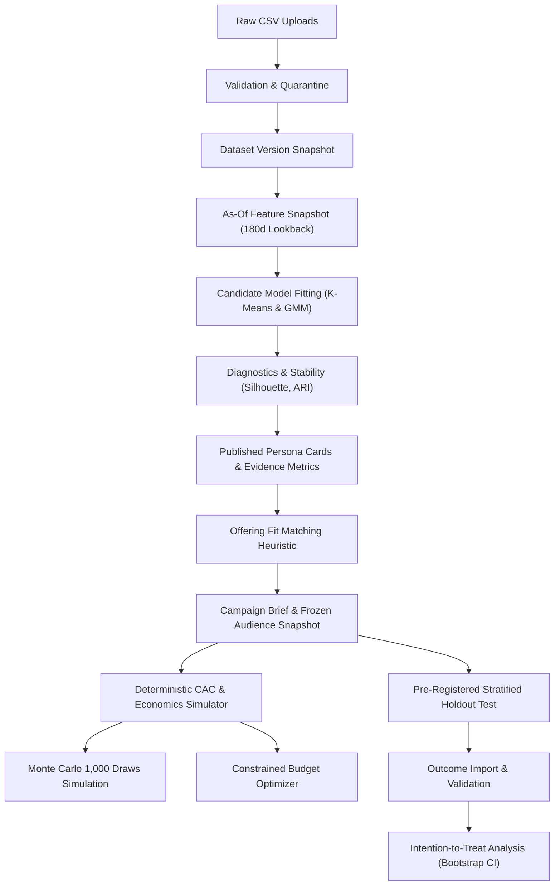

# Architecture & System Design — Persona Studio

**Project:** Persona Studio – Customer Segments & Campaign Planner for Marketers  
**Architecture Version:** 1.0.0  
**Date:** 13 October 2026  

---

## 1. System Overview

Persona Studio is built as a modular full-stack application separating pure analytical calculations, asynchronous background worker jobs, REST APIs, and a Next.js App Router frontend workspace.

---

## 2. Logical Analytics Pipeline

Every user action advances through an immutable, versioned data pipeline:

---

## 3. Storage Schema & Database Entities

The relational database is managed with Alembic migrations and contains 16 core entities:

1. **`workspaces`**: Workspace settings, currency, timezone, synthetic demo flag.
2. **`dataset_versions`**: Ingested datasets, status (`uploaded`, `validated`, `features_ready`), row counts, coverage period.
3. **`upload_files`**: Raw CSV file references, storage paths, file hashes, row counts.
4. **`validation_issues`**: Line-level error and warning audits with quarantine flags.
5. **`customers`**: Canonical customer profiles with signup timestamp and opt-in consent flags.
6. **`order_lines`**: Item-level completed/cancelled orders with unit list prices, discounts, and refunds.
7. **`offerings`**: Catalog of products, services, and finite-horizon subscriptions with unit variable costs.
8. **`engagement_events`**: Multi-channel marketing touchpoints (views, clicks, sessions, cart events).
9. **`feature_snapshots`**: As-of behavioral feature matrix metadata with strict lookback window isolation.
10. **`customer_features`**: Precomputed RFM, category share, and discount metrics per profile.
11. **`segmentation_runs`**: Unsupervised model runs with evaluated candidates, 2D PCA coordinates, and ARI stability scores.
12. **`persona_cards`**: Versioned decision objects with behavioral glyphs, audience counts, fingerprints, and hypotheses.
13. **`evidence_metrics`**: Immutable evidence records tying every observed claim to underlying source columns and baseline values.
14. **`campaigns`**: Saved campaign briefs with deduplicated target audience partitions, discount math, and copy variants.
15. **`experiments`**: Pre-registered holdout tests with target MDE, power, and sample size calculations.
16. **`experiment_assignments`**: Frozen 50/50 randomized arm assignments stratified by persona.
17. **`experiment_outcomes`**: Verified post-campaign customer outcomes with complete window verification.
18. **`jobs`**: Asynchronous worker execution table with lease heartbeats and atomic status transitions.

---

## 4. Asynchronous Worker Execution Contract

- **Concurrency & Locking:** The worker uses PostgreSQL transactions with `SELECT ... FOR UPDATE SKIP LOCKED` to safely claim queued jobs across multiple workers.
- **Heartbeat & Leases:** Active jobs update their `heartbeat_at` timestamp every 15 seconds. If a worker process halts, jobs exceeding the lease timeout are recovered.
- **Idempotency:** Re-running a completed job ID yields identical artifacts without mutating previous runs.

---

## 5. Security & Configuration Boundaries

- **Local Mode (Default):** Unrestricted single-workspace local development mode bound to localhost.
- **Protected Owner Mode:** Single configured owner password hashed via Argon2, HttpOnly / SameSite session cookies, CSRF protection on mutations.
- **Read-Only Demo Mode:** Mutation endpoints disabled server-side, synthetic demo data loaded, isolated simulation previews permitted.
- **LLM Decoupling:** Client browser never communicates with external AI services. LLM calls are server-side only; missing API keys automatically invoke the deterministic template engine without failing.
